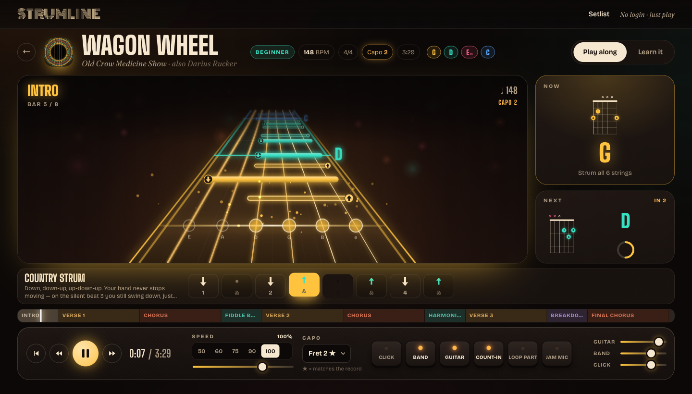

# Strumline — play-along acoustic guitar trainer (POC)

Guitar-Hero-style highway for learning real songs on acoustic. No build step, no backend, no login.

**Try it:** https://tycenjmccann.github.io/strumline/



Built in one session with Claude Code (Claude Opus 5.5): 1h 16m wall clock, 1 prompt, ~$8.70 in tokens at API list rates.

## Run

- Double-click `index.html` (works from `file://`), **or**
- Double-click `start.command` → serves on http://127.0.0.1:8765 and opens the browser.

Fonts load from Google Fonts (falls back to system fonts offline). Everything else is local.

## What's in it

| Area | What it does |
|---|---|
| Setlist | 28 full songs: 19 beginner, 9 intermediate, 7 kids singalongs (Kids filter), with generated cover art |
| Play along | 3D note highway (strums, picks, mutes, chord gates, section tags), live NOW/NEXT chord boxes with gliding finger dots, step-by-step strum strip, clickable song map |
| Audio | 100% synthesized in Web Audio: Karplus–Strong acoustic strings + body EQ + room reverb, cajón kit, plucked bass, metronome. No samples. |
| Practice | Speed 40–125%, loop a section, capo 0–7 (audio follows), count-in, mute guide guitar/band/click, per-bus volume |
| Learn it | Chord cards (tap to hear), pattern cards with "Hear it", every chord change with an auto-generated finger tip + **Drill it**, road map, pro tips |
| Drills | Generated mini-songs that work one change slow → on the beat → song strum |
| Jam mic | Mic onset detection scores your strum timing (PERFECT / GOOD / LATE / MISS, streaks, multiplier). Use headphones. |

Keyboard: `Space` play/pause · `←/→` bar · `↑/↓` speed · `L` loop · `M` click · `R` restart

## Add a song

Create `js/songs/<id>.js` with `GS.registerSong({...})` (schema documented at the top of `js/songs/wagon-wheel.js`), add a `<script>` tag in `index.html`, then run `node tools/validate-songs.js`. Chords come from `GS.theory.CHORDS` or a song-level `shapes` override. Chords/structure only — no lyrics.

## Code map

```
js/theory.js     tuning, chord shapes, finger/anchor tips, song registry
js/arrange.js    song → beat timeline (hits, chord spans, band notes), drill generator
js/synth.js      Karplus–Strong string renderer + sound bank
js/engine.js     Web Audio graph, strum/pick/mute/drums/bass/click voices
js/player.js     lookahead scheduler on the audio clock (speed, loop, count-in)
js/highway.js    canvas note highway renderer
js/diagram.js    animated SVG chord boxes
js/jam.js        mic onset detection + scoring
js/app.js        routing, setlist, song/learn/drill views
```
